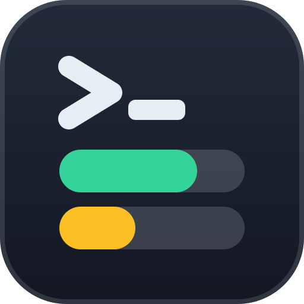
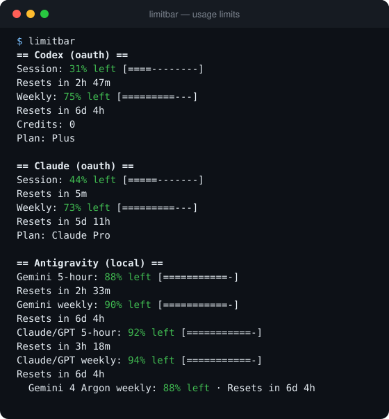
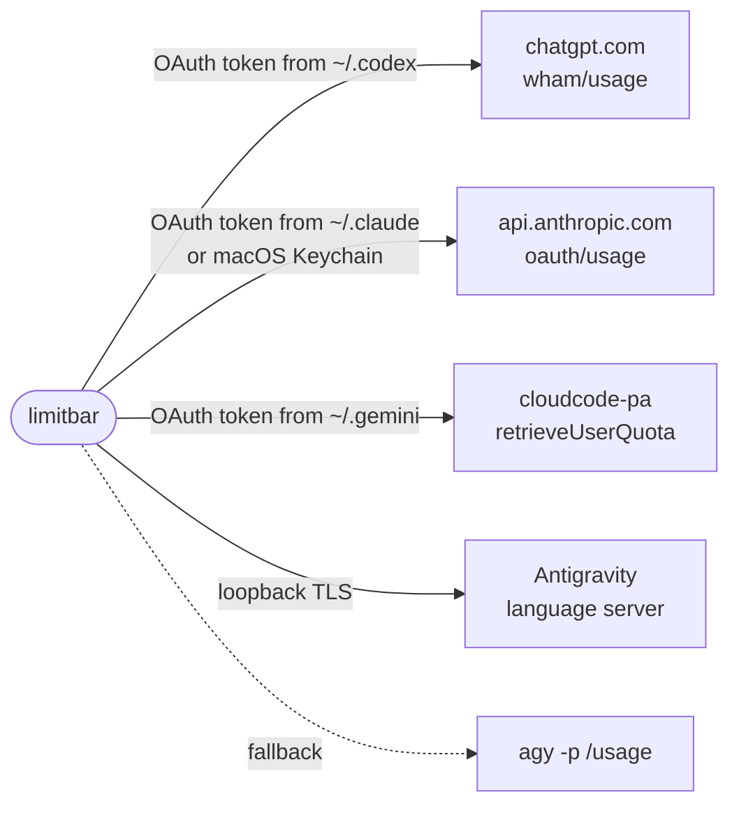

<p align="center">
  
</p>

<h1 align="center">limitbar</h1>

<p align="center">
  <strong>How much AI quota do you have left?</strong><br>
  Session and weekly limits for Codex, Claude, Antigravity and Gemini, in one terminal command.
</p>

<p align="center">
  
  
  
  
</p>

<p align="center">
  
</p>

## Why

Every AI tool hides its limits somewhere different: a settings page, a slash command, a
dashboard. limitbar asks all of them at once and prints one short report, so you know
which model to reach for before you start a long task.

- **No new login.** It reads the sign-in your tools already keep on this machine.
- **Finds your providers by itself.** Signed in to Codex and Claude? Just run `limitbar`.
- **Fast.** Providers are queried in parallel; a full report takes a few seconds.
- **Script friendly.** `--json` output and meaningful exit codes.
- **Small.** A single 3 MB binary that only depends on libc.

## Providers

| Provider | Source | Reads | Shows |
| --- | --- | --- | --- |
| **Codex** | OAuth | `~/.codex/auth.json` (`codex login`) | 5-hour session, weekly, credits, plan |
| **Claude** | OAuth | `~/.claude/.credentials.json`, or the macOS Keychain (Claude Code) | 5-hour session, weekly, per-model weekly, plan |
| **Antigravity** | Local | running language server, else `agy -p /usage` | Gemini and Claude/GPT pools, per-model pools |
| **Gemini** | OAuth | `~/.gemini/oauth_creds.json` (Gemini CLI) | daily Pro / Flash / Flash Lite, plan |



### About tokens

limitbar **never refreshes** Codex or Claude tokens. Those tokens belong to their tools,
and refreshing them rotates the refresh token, which would sign the tool out. When a
token has expired, limitbar tells you; open `codex` or `claude` once and run it again.
The Gemini CLI expects whoever uses its token to refresh it, so limitbar refreshes it
and writes it back with the same private permissions.

Tokens are only ever sent to the provider they belong to, and are never printed,
logged or written anywhere else. The Antigravity language server is reached over TLS on
`127.0.0.1` only.

On macOS, Claude Code keeps its login in the Keychain item `Claude Code-credentials`.
limitbar reads it with `/usr/bin/security` and keeps only the `claudeAiOauth` entry;
anything else in that item (such as MCP server tokens) is discarded right away. macOS may
ask once whether to allow access. The Keychain is skipped when `CLAUDE_CONFIG_DIR` is set.

## Usage

```sh
limitbar                       # every provider you are signed in to
limitbar -p claude -p codex    # only these
limitbar --json                # JSON for scripts
limitbar --hide-account        # hide account emails
limitbar providers             # which providers are signed in
limitbar providers --json      # the same, as JSON
```

`--json`, `--no-color` and `--hide-account` work before or after any subcommand.

| Exit code | Meaning |
| --- | --- |
| `0` | every provider answered |
| `1` | at least one provider failed (its error is in the report) |
| `2` | invalid arguments |

<details>
<summary>JSON output</summary>

```json
[
  {
    "provider": "claude",
    "name": "Claude",
    "source": "oauth",
    "plan": "Claude Pro",
    "windows": [
      { "label": "Session", "used_percent": 56.0, "window_minutes": 300, "resets_at": "2026-11-20T11:39:59Z" },
      { "label": "Weekly", "used_percent": 27.0, "window_minutes": 10080, "resets_at": "2026-11-25T22:59:59Z" }
    ]
  }
]
```

A provider that fails appears as `{ "provider": "...", "name": "...", "error": "..." }`.
With `--hide-account`, the `account` field is left out.
</details>

## Install

**Debian / Ubuntu** (24.04+ / Debian 13+, glibc 2.39+):

```sh
git clone https://github.com/yasinkaratoprak/limitbar && cd limitbar
scripts/build-deb.sh                          # target/debian/limitbar_<version>_<arch>.deb
sudo apt install ./target/debian/limitbar_*.deb
```

**macOS, or anywhere with Rust:**

```sh
cargo install --path .
```

## Development

```sh
cargo test
cargo run -- --json
```

To add a provider, create a file under `src/providers/` that implements the `Provider`
trait and add it to `providers::all()`.

The terminal image in this README is generated from real output:

```sh
script -qc "limitbar --hide-account" /dev/null | python3 scripts/render-terminal.py > docs/terminal.svg
```

The logo is `docs/logo.svg`; `docs/social-preview.png` is the repository's social preview image.

## Acknowledgements

Provider endpoints and response mappings follow [CodexBar](https://github.com/steipete/CodexBar)
by Peter Steinberger (MIT). limitbar is an independent tool written from scratch in Rust.

## License

[MIT](LICENSE)
